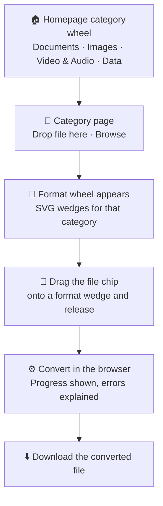
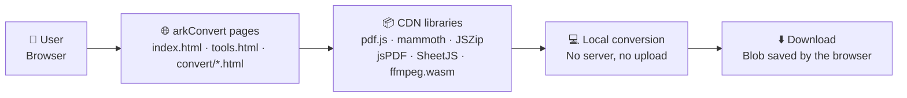

<div align="center">

# 🔄 arkConvert

### Convert anything, right in your browser. No uploads, no waiting, no sign-up.

[](https://github.com/AbdurRahmanKhan000/arkConvert)
[](https://github.com/AbdurRahmanKhan000/arkConvert)
[](https://github.com/AbdurRahmanKhan000/arkConvert)
[](https://github.com/AbdurRahmanKhan000/arkConvert)
[](https://github.com/AbdurRahmanKhan000/arkConvert)

**arkConvert is a free, private, browser-side file converter with a true wedge wheel.** Pick a category, drop a file, drag it onto a format wedge, and download the result — the file never leaves your device.

[✨ Features](#-features) · [🎡 Wheel Flow](#-wheel-flow) · [🏗️ Architecture](#️-architecture) · [🛠️ Tech Stack](#️-tech-stack) · [🚀 Getting Started](#-getting-started)

</div>

---

## 📑 Table of Contents

- [🎯 Why arkConvert Exists](#-why-arkconvert-exists)
- [✨ Features](#-features)
- [🔄 Conversion Matrix](#-conversion-matrix)
- [🎡 Wheel Flow](#-wheel-flow)
- [🏗️ Architecture](#️-architecture)
- [🛠️ Tech Stack](#️-tech-stack)
- [📁 Project Structure](#-project-structure)
- [🚀 Getting Started](#-getting-started)
- [👨‍💻 Author & Contact](#-author--contact)
- [📄 License](#-license)

---

## 🎯 Why arkConvert Exists

Most online converters upload your documents, images, videos and spreadsheets to someone else's server, ask for an account, and make you wait in a queue. arkConvert exists to remove all three steps:

1. **Your file stays yours.** Conversion code runs in your browser, so documents, images, video and data are processed on your own device.
2. **One gesture does the work.** The wedge wheel replaces long menus and upload forms: choose a category, drop a file, drag it onto a format.
3. **Nothing to install, nothing to configure.** arkConvert is a static site — open it, convert, download, done.

---

## ✨ Features

| | Feature | How it works |
| :--- | :--- | :--- |
| 🎡 | **True wedge wheel** | SVG pie/donut wedges around a centre. The wheel turns slowly (about 105 seconds per revolution) and pauses on hover, while dragging, and while converting, so the target stays stable. |
| 🖱️ | **Two-stage flow** | Homepage wheel picks a category. The category page shows only Drop / Browse first. The format wheel appears only after a file arrives. |
| 📎 | **Drag the file chip** | After a file arrives, drag its chip onto a format wedge and release to convert. Tapping a wedge also works, for touch and keyboard use. |
| 🔒 | **Private by design** | No account, no sign-up, no server upload for conversion. Files are processed locally in the browser. |
| 🧭 | **One page per conversion** | `convert/` holds a dedicated page for each pair — PDF to Word, PNG to JPG, MP4 to MP3, Text to Excel, and more — each with its own format wheel. |
| 📝 | **Public blog, owner-only writing** | Blog pages are public to read. The admin page is not linked in navigation and is gated to the owner only. |
| ⚠️ | **Clear conversion errors** | A failed conversion hides the Download button, clears progress, explains what went wrong in plain words, and offers Retry and Change file. A failed or empty result is never offered for download. |

---

## 🔄 Conversion Matrix

### Documents

| From | To |
| :--- | :--- |
| PDF | TXT, Word (DOCX), Markdown, PowerPoint (PPTX), JPG, PNG |
| Word (DOCX) | TXT, Markdown, PDF |
| Text / Markdown | Word (DOCX), PDF, PowerPoint (PPTX) |
| PowerPoint (PPTX) | TXT, Markdown |

### Images

| From | To |
| :--- | :--- |
| PNG, JPG, WebP, GIF, BMP, AVIF, HEIC | PNG, JPG, WebP, GIF, BMP, AVIF, PDF |

### Video & Audio

| From | To |
| :--- | :--- |
| MP4, MOV, MKV, WebM | MP3, MP4, MKV |

Video uses a single-thread ffmpeg.wasm build, so it works without cross-origin isolation headers.

### Data

| From | To |
| :--- | :--- |
| Text | CSV, Excel (XLSX) |
| CSV | Excel (XLSX), Text |
| Excel (XLSX) | CSV, Text |

---

## 🎡 Wheel Flow



---

## 🏗️ Architecture



There is no backend, no database, and no file storage. Converter libraries load lazily, only when the conversion that needs them starts.

---

## 🛠️ Tech Stack

| Package / Technology | Purpose in arkConvert |
| :--- | :--- |
| **HTML, CSS, JavaScript** | The whole site — no framework, no build step |
| **SVG** | Wedge wheels, slow rotation, upright labels |
| **pdf.js** | PDF text extraction and PDF-to-image rendering |
| **mammoth** | Word (DOCX) to text and Markdown |
| **JSZip** | Word and PowerPoint file construction and reading |
| **jsPDF** | Text to PDF |
| **pptxgenjs** | Text to PowerPoint |
| **SheetJS (XLSX)** | CSV and Excel conversion |
| **ffmpeg.wasm 0.12 (single-thread core)** | Video and audio conversion without SharedArrayBuffer |
| **heic2any** | HEIC image decoding where the browser needs it |

---

## 📁 Project Structure

```bash
arkConvert/
├── index.html          # Homepage: category wheel + About the author
├── tools.html          # Category converter: Drop/Browse, then format wheel
├── convert/            # One page per conversion pair (28 pages)
│   ├── pdf-to-word.html
│   ├── png-to-jpg.html
│   ├── mp4-to-mp3.html
│   └── text-to-csv.html
├── blog/               # Public blog list and post pages
├── admin.html          # Owner-only blog admin (not linked in navigation)
├── assets/
│   ├── style.css       # Light bronze professional theme
│   ├── app.js          # Wedge wheels + all converters + error handling
│   └── blog.js         # Blog posts
├── robots.txt          # Admin page excluded from crawling
├── sitemap.xml         # All public pages
├── vercel.json         # Static-site configuration
└── README.md           # This file
```

---

## 🚀 Getting Started

No dependencies to install. Preview the site locally with any static server:

```bash
python3 -m http.server 8000
```

Then open http://localhost:8000/

Try it in this order: homepage wheel → Documents → drop a PDF → drag the file chip onto DOCX → download.

---

## 👨‍💻 Author & Contact

**Abdur Rahman Khan**

*Computer Science Undergraduate | DevOps & Cloud Engineer | Certified Ethical Hacker | Programming Expert | AI System Developer — UET Peshawar, Peshawar, Pakistan.*

arkConvert is part of the **ARK Ecosystem** — arkEngine, arkBrowse, GitGuard, PasteWrap, DevCost Lens, arkAI, Tech by ARK, and arkConvert.

[](https://github.com/AbdurRahmanKhan000)
[](https://portfolio-arkmfk.vercel.app/)
[](https://www.linkedin.com/in/abdur-rahman-khan-a51ba33ab/)
[](mailto:arkmfk27@gmail.com)

---

## 📄 License

*Not yet specified.* Add your chosen license here (e.g. MIT, Apache-2.0, or "Private & Proprietary — all rights reserved") before publishing this repository publicly.

---

**arkConvert** — convert anything, right in your browser. No uploads, no waiting, no sign-up.
